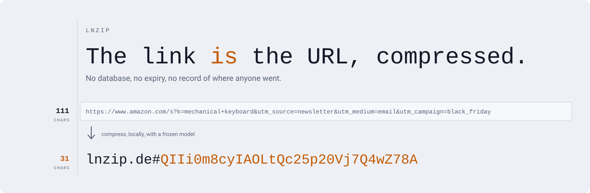
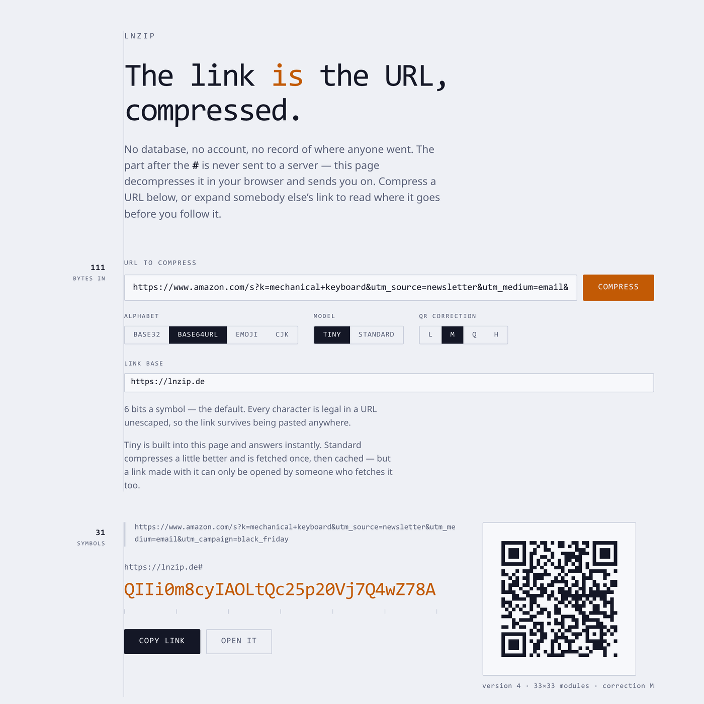
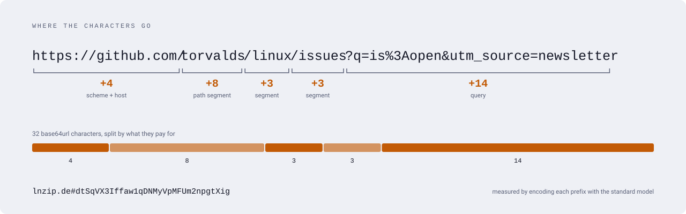
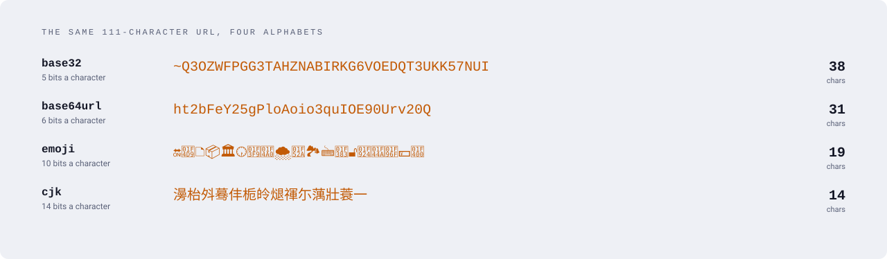
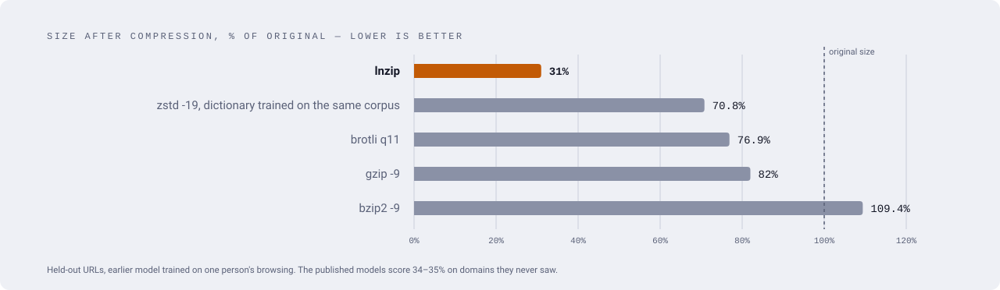
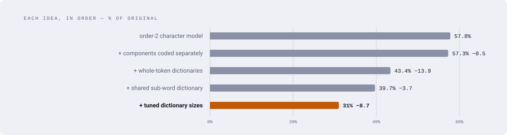

<p align="center">
  <picture>
    <source media="(prefers-color-scheme: dark)" srcset="docs/img/hero-dark.svg">
    
  </picture>
</p>

<p align="center">
  <a href="https://lnzip.de"><b>lnzip.de</b></a> ·
  <a href="#quick-start">Quick start</a> ·
  <a href="#how-it-compresses">How it works</a> ·
  <a href="#results">Results</a> ·
  <a href="https://github.com/Caua726/lnzip/releases/tag/models">Models</a>
</p>

<p align="center">
  <a href="LICENSE"></a>
  <a href="https://github.com/Caua726/Caustic"></a>
  <a href="https://lnzip.de"></a>
  
</p>

**lnzip is a lossless compressor for URLs.** It is not a URL shortener in the
usual sense. A shortener is a database: `abc123` is a key, and the link dies
when the table does. lnzip has no table — the code **is** the URL, compressed.
`lnzip.de#CODE` resolves by decoding `CODE`, not by looking it up:

- **no storage, no expiry** — a link works for as long as the model exists, and the model is frozen;
- **no record** — the code lives after the `#`, which browsers never send to a server;
- **offline** — anyone holding the same model can resolve a link with no network at all.

## Try it

Open **[lnzip.de](https://lnzip.de)**, paste a URL, get a link and its QR code.
Or paste somebody else's link to read where it goes before following it.

<p align="center">
  <picture>
    <source media="(prefers-color-scheme: dark)" srcset="docs/img/page-dark.png">
    
  </picture>
</p>

The page is the codec compiled to WebAssembly with the tiny model built in. It
decompresses in the reader's browser and sends them on; the destination never
reaches any infrastructure at all. That is not a policy about logs — there is
nothing to log with.

## Quick start

Requires the Caustic toolchain (≥ v0.1.8). The first build clones the pinned
[`caustic-compact`](https://github.com/Caua726/caustic-compact) into `.caustic/deps`.

```sh
git clone https://github.com/Caua726/lnzip && cd lnzip
caustic-mk run models          # fetch the published models, check their sha256
caustic-mk build lnzip
```

```console
$ export LNZIP_MODEL=models/lnzip-standard-1.lnzm

$ ./build/lnzip encode 'https://github.com/torvalds/linux/issues/123'
dtSwnunEffaw1qDNMyWc

$ ./build/lnzip decode dtSwnunEffaw1qDNMyWc
https://github.com/torvalds/linux/issues/123

$ ./build/lnzip encode 'https://github.com/torvalds/linux/issues/123' -a cjk
段変覧剽讬孪儴脥甀
```

| command | |
|---|---|
| `lnzip encode <url> [-a alphabet] [-v]` | compress; `-v` reports sizes on stderr |
| `lnzip decode <code>` | decompress; the alphabet is detected |
| `lnzip info` | the model's id, tier, size and integrity |
| `-m <model.lnzm>` | the model to use; `$LNZIP_MODEL` otherwise |

With no model at all the tool still runs, against a uniform built-in one that
compresses nothing. It exists so the codec works before a corpus does, and
encoding with it says so on stderr.

## How it compresses

It doesn't treat a URL as text. It knows the grammar — scheme, host, path,
query, fragment — and spends bits only on what is unpredictable:

<p align="center">
  <picture>
    <source media="(prefers-color-scheme: dark)" srcset="docs/img/anatomy-dark.svg">
    
  </picture>
</p>

`https`, `/`, `?`, `=`, `&`, `#` and common hosts cost a fraction of a bit each
or vanish entirely. Hosts, path segments, query keys and values go through
whole-token dictionaries, with a shared sub-word dictionary underneath for the
tokens that miss, and an order-2 character model below that.

The philosophy is closer to AV1 than to LZ4: exploit knowledge of what the data
*is* rather than search it for repeats. A structural pass turns the URL into
tokens, and a binary range coder with pre-trained, frozen probabilities turns
those tokens into bits. The probability tables live in an external model file,
so **not one byte of table rides in the payload**.

Every input round-trips byte for byte, URL or not. The encoder builds a
structural payload and a raw one (the character model alone) and emits
whichever is shorter.

## Alphabets

The payload is bits; the alphabet decides how they are written down.

<p align="center">
  <picture>
    <source media="(prefers-color-scheme: dark)" srcset="docs/img/alphabets-dark.svg">
    
  </picture>
</p>

- **`base64url`** is the default: every character is legal unescaped in a URL.
- **`base32`** is for a link read aloud or typed off a screen — it is case-insensitive.
- **`emoji`** and **`cjk`** spend the fewest visible characters.

`decode` takes no alphabet: three of the four say which they are just by being
themselves, and base32 — whose characters are all legal base64url — carries a
leading `~`. Fewest characters is not smallest QR code, though: a QR carries
bytes, and a CJK ideograph is three of them.

## Results

The published models, on URLs from domains they never saw in training:

| model | file | transferred | size of original |
|---|---|---|---|
| id 0 · tiny | 9.5 MB | 615 KB | **35%** |
| id 1 · standard | 11.5 MB | 1.4 MB | **34%** |

Against general-purpose compressors at their best settings — each given every
advantage, zstd even a dictionary trained on the same corpus:

<p align="center">
  <picture>
    <source media="(prefers-color-scheme: dark)" srcset="docs/img/compare-dark.svg">
    
  </picture>
</p>

Losslessness is gated on a corpus rather than on chosen examples — every URL
round-tripping byte for byte, run again on every change:

```sh
caustic-mk build corpus && ./build/corpus <file-of-urls> [model.lnzm]
```

<details>
<summary><b>How it got there</b> — each idea and what it bought</summary>

<br>

<p align="center">
  <picture>
    <source media="(prefers-color-scheme: dark)" srcset="docs/img/ablation-dark.svg">
    
  </picture>
</p>

Measured on an earlier model trained on one person's browsing (5184 domains),
on URLs held out from the same corpus. On sites that model had never seen, the
same 31% became 51% — the size of the overfit, and the reason the published
models were trained on public data instead.

**A dictionary has an optimum, not a ceiling.** Keeping every distinct token
the corpus contains scores *worse* than keeping a third of them: 32% against
31%, for two and a half times the size. A token costs its rank, not its
presence — a word around rank 100000 costs some 34 bits to name and about 32 to
spell out, so past a point each new entry is a loss that also has to be
downloaded.

This is also why a language dictionary would not help. `the` is the commonest
word in English and rare in URLs; `utm_source` is a word in no language and one
of the commonest tokens on the web. Only the corpus knows the frequencies that
matter.

**Context mixing did not pay.** Implemented in integer arithmetic and
round-tripping 400000 URLs, its best configuration matched not mixing at all.
The two models it mixed were one opinion at two focal lengths, not two
opinions; making it pay needs a genuinely independent model, which is new
model bytes.

</details>

## What it does not do

Against a URL carrying a random identifier, **no compressor beats a database**
— that is information theory, not engineering. `youtube.com/watch?v=dQw4w9WgXcQ`
holds 66 bits of pure randomness in the ID; the best possible payload is about
72 bits, or 12 base64url characters, where bit.ly spends 7. The same is true
of ASINs, UUIDs and commit hashes.

Where lnzip wins is structural and textual URLs — wikis, docs, GitHub, news,
slugged product pages — and above all long URLs carrying `utm_*` and tracking
parameters. And it wins on the thing a database cannot offer at any size: no
state.

## Models are permanent

A link names the model it was coded against, so a published model id is frozen
forever — a link minted today has to resolve in ten years. A published model is
never re-edited and its id is never reassigned; a retrain gets a new id and the
old file stays distributed. Training is byte-reproducible for the same reason.

The files are [release assets](https://github.com/Caua726/lnzip/releases/tag/models),
not source. Their sha256 lives in [`models/MANIFEST`](models/MANIFEST), because
a link whose model was lost is a dead link and the hash is what proves a
recovered copy is the right one.

Both were trained on **public data**, and that is a requirement rather than a
convenience: a dictionary holds the tokens its corpus contained, so a model
trained on someone's browsing would publish their searches. They come from 27
million URLs of a Common Crawl index filtered to English and Portuguese, with a
floor of eight sightings before a token may enter a dictionary, and the host
dictionary seeded from a public popularity list.

```sh
caustic-mk build train && ./build/train <corpus> <out.lnzm> [id] [tier]
```

## Safe to follow

With no database behind it, a fragment resolves to whatever it decodes to — so
the page only ever navigates to `http` and `https`, and that check runs inside
the wasm rather than in the page script. It is the difference between a
shortener and a `javascript:` delivery mechanism. A code that decodes to
anything else is shown as inert text.

## Building the page

```sh
caustic-mk run web          # build/site/ for lnzip.de, build/lnzip.html standalone
caustic-mk run web-test     # checks the wasm boundary with node
```

`build/lnzip.html` is a single self-contained file — the wasm, the model and a
WASI shim of about fifty lines — that opens from `file://` with no server.

## Layout

```
core/errno.cst      error codes
url/split.cst       lossless segmentation: offsets only, nothing transformed
entropy/rc.cst      binary range coder with external, frozen probabilities
model/fmt.cst       model file format, loader, integrity check
model/ctx.cst       context → probability index, shared by codec and trainer
model/dict.cst      front-coded dictionaries
codec/codec.cst     the grammar: encoder, decoder and trainer walk side by side
fmt/alpha.cst       the four output alphabets
train/              token counting for the trainer
cli/main.cst        the command line tool
tools/              trainer, corpus gate, wasm embed and bundler
wasm/  web/         the browser build and the page
tests/              the suites and their runner
docs/design.md      the original plan and its phases
```

```sh
caustic-mk run test        # every suite
caustic-mk run test-opt    # the same through the optimizing backend
```

## License

[MIT](LICENSE) — Cauã Alvarenga Neves.
